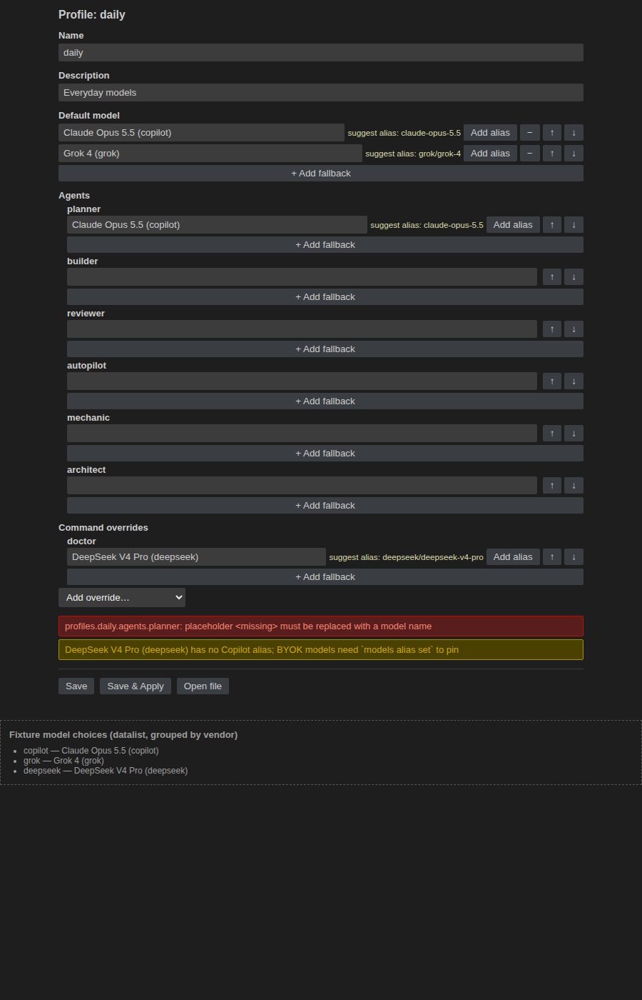
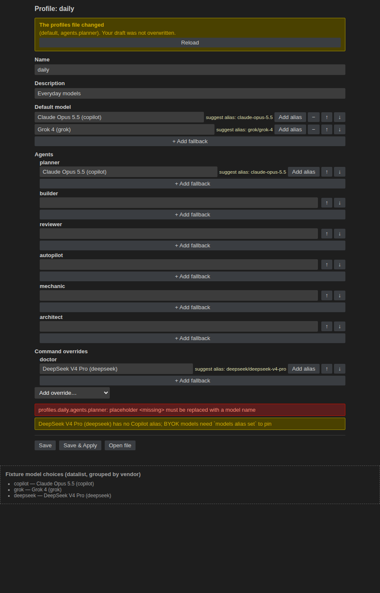
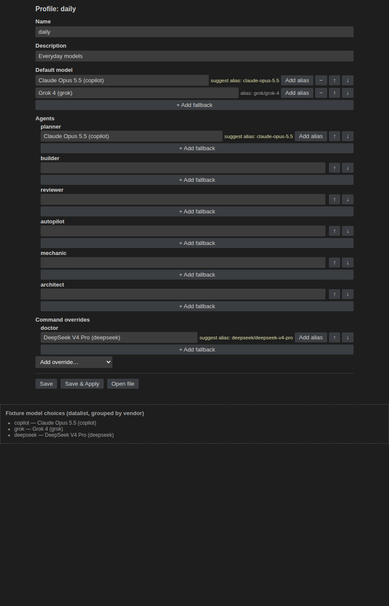

# Review: model-profile-editor

Verdict: approve

Round 2, reviewed 2026-10-21 at product `7d8acdf` (branch `feature/model-profile-editor`,
code PR david-perry-software/agento#126) against companion `41c497c` (artifact PR
david-perry-software/agento-docs#63). Round 1 (companion `f76c26a`, product `dcbe9ee`)
requested changes for two major defects; the Builder answered with steps 4.4, 4.5, and
5.2 (product `fdb2790`, `d66faac`, `7d8acdf`). `origin/main` is an ancestor of HEAD in
both halves and both halves were in sync with `origin/feature/model-profile-editor`
(0/0 ahead-behind) and clean before every check. Skills consulted: none — the plan's
`Skills consulted: none — no matching domain` still holds (no `## Agento` skills table
in AGENTS.md, no `.agents/skills/`).

## Fresh verification (all run by the Reviewer)

| Check | Result |
| --- | --- |
| `/tmp/shellcheck-v0.10.0/shellcheck scripts/hooks/*.sh scripts/wait-for-checks.sh` | exit 0, 0 findings (baseline: 0) |
| `node --test 'scripts/**/*.test.mjs' 'tests/**/*.test.mjs'` | exit 0, **612/612** (baseline 609) |
| five guard smoke replays from AGENTS.md | 5/5 exit 0 |
| `cd extension && npm ci && npm run build && npm run typecheck && npm run test:unit` | exit 0, **201/201** (baseline 183) |
| `node --check media/profileEditor.js` | exit 0 |
| `DISPLAY=:0 npm run test:electron` | exit 0, 4/4 scenarios; in-repo log: `… model profiles, model-profile editor` |
| `npm run package` + `unzip -l agento-dashboard-0.11.0.vsix` | exit 0; lists `extension/media/profileEditor.js` (15828 B) and `.css` (4002 B); no `test/webview` |
| `DISPLAY=:0 npm run test:vsix` | exit 0 (`VSIX install smoke passed`); `.vsix` removed afterwards |
| harness on `local:3177` (headless Chrome `--dump-dom`), plain / `?conflict=1` / `?keepDraft=1` | all three: 11 `<input>`s, footer present, 7 datalist `<option>`s, no `#csp-violation`, no `#uncaught-error`; conflict variant has exactly one Reload |
| `git status --porcelain --untracked-files=all` (both halves) | empty after every run (companion: only this review's evidence) |

### Independent reproduction of the round-1 defects

A stub `vscode` module (ESM loader hook) drove the compiled
`out/src/profileEditorPanel.js` through `handleMessage` with a temp
`AGENTO_CONFIG_HOME` and the real CLI (`extension/cli/agento.mjs`); 16 checks, all
outside the repository tree:

- **Defect 1 (dirty-then-save).** `change dirty:true → save` wrote the body and the
  last posted message was `state` with `hash` = `models show` `profilesFile.hash`
  (`d53194da…` on both sides); the panel title dropped the `●`. A second
  `change dirty:true → save` posted `state` (not `conflict`) and wrote the second
  edit. A dirty rename (`review` → `renamed`) re-keyed the panel and posted the new
  file hash with title `Profile: renamed`. **16/16 pass against `7d8acdf`.**
- **Negative control.** The same script against a `/tmp` build of `dcbe9ee` (the
  round-1 code, `git archive` + `tsc`) fails exactly as round 1 reported: posted
  `state` hash `16f43091…` vs file `d53194da…`, title still `● Profile: review`,
  second save → `{"type":"conflict","changed":["description","default"]}`, second
  edit not written. So the reproduction is sensitive and step 5.2's "fails against
  the pre-4.4/4.5 code" claim holds.
- **Defect 2 (addAlias refresh).** After `change dirty:true → addAlias`, the host
  posted `{ type: "state", keepDraft: true, name, form, pinnable, choices,
  copilotModels, hash, unknownKeys }` — every key `renderForm` reads — with the new
  file hash and `copilotModels["Grok 4 (grok)"] = "grok/grok-4"`; the host kept its
  dirty state (`● Profile: watched`), and a following `save` of the draft was not a
  conflict. That exact captured message was then posted to the real
  `media/profileEditor.js` in headless Chrome after an initial `state` whose draft
  description was `typed but unsaved`: the form re-rendered (9 inputs, footer), the
  draft description stayed `typed but unsaved`, `baseHash` became the new hash, and
  no error fired. The old partial `{ type: "state", keepDraft, name, copilotModels,
  hash }` message in the same page still produced 0 inputs and an uncaught error —
  the negative control for Finding 2.

Reviewer screenshots (fresh renders of the committed harness on `local:3177` at this
HEAD): 

.

## Acceptance checklist results

1. **CLI (`pinnable`, `body`, unchanged fields, shared `isPinnablePrompt`)** — **pass.**
   Unchanged since round 1: `scripts/model-profiles.mjs` exports `isPinnablePrompt`
   and `resolveTargets` calls it; `scripts/agento.mjs` adds `pinnable` to `list` and
   `body` to `show`, both additive. Root suite 612/612 (609 + 3 new);
   `tests/extension-bundle.test.mjs` passes, so `extension/cli/` matches `scripts/`.
2. **`CliClient.run` stdin + arg builders** — **pass.** `extension/src/cliClient.ts`
   ends stdin with or without input; `cliClient.test.ts` and `modelProfiles.test.ts`
   pass in the 201/201 run.
3. **Pure editor model** — **pass.** `profileEditorModel.test.ts` (12 tests: round
   trip, one-item↔string, omission, unknown keys, vendor grouping,
   `suggestAlias`/`aliasStatus` for Copilot/BYOK/qualified/id-less, every message
   type accepted and malformed/unknown rejected, `diffFields`, `validateRename`) pass.
4. **`renderEditorHtml` CSP/nonce/no remote/no inline** — **pass.**
   `profileEditorHtml.ts:38` emits exactly the planned CSP; `profileEditorHtml.test.ts`
   (4 tests) pass.
5. **Editor behavior in the in-repo electron scenario (10 checks)** — **pass.** All
   ten checks are in `extension/test/electron/suite.ts` `assertModelProfileEditor` and
   the suite passes 4/4. Since round 1, checks 4–6 are preceded by
   `change { form, dirty: true }` (`suite.ts:973-1032`), each save asserts the posted
   `state.hash` equals `models show` `profilesFile.hash`
   (`waitForStateHash`, `:968`), a following edit + save is asserted not to conflict
   (`:1033-1046`), and check 8 asserts the post-alias refresh carries `form`,
   `pinnable`, `choices`, `unknownKeys`, `copilotModels`, and the new `hash`
   (`:1069-1094`). The round-1 gap between the test flow and the real webview flow is
   closed; my independent reproduction above confirms the behavior.
6. **Temp `AGENTO_CONFIG_HOME` guard + clean tree after electron** — **pass.** The
   `profilesFile.path`-under-temp-home assertion still precedes every write;
   `git status --porcelain --untracked-files=all` was empty after my electron run.
7. **Visual evidence** — **pass.** Builder's `evidence/step-6-2-editor-form.png` and
   `step-6-2-editor-conflict.png` exist and are linked from step 6.2. My fresh renders
   (`review-step-6-2-*.png`, above) show the grouped datalist (7 `<option>`s across
   the fixture choices), the two-entry Default fallback list, the `doctor` override,
   the inline error and warning, alias suggestions with **Add alias**, and the
   conflict banner with only **Reload**. No CSP violation marker in any variant.
8. **VSIX ships the webview assets** — **pass.** `npm run package` exit 0; `unzip -l`
   lists both media files and no `test/webview`; `npm run test:vsix` exit 0; the
   `.vsix` was removed.
9. **Docs and release** — **pass.** Unchanged since round 1: `docs/model-profiles.md`,
   `docs/extension.md`, `extension/README.md` describe the editor and the
   `pinnable`/`body` fields; `CHANGELOG.md` has `## 0.11.0 (unreleased)` **Added**;
   `0.11.0` in all four version files (both lock fields).
   `tests/customizations.test.mjs` passes inside the 612/612 run.
10. **Lint gate (§5, full rerun)** — **pass.** shellcheck exit 0 / 0 findings equals the
    recorded baseline; root 612 ≥ 609 + new; unit 201 ≥ 183 + new; electron 4/4;
    guard replays 5/5. The fix commits touch no shell file; no new or undocumented
    findings.

## Plan vs implementation

- Plan `## Approach` item 5 "On success: post the new state, clear dirty, reload the
  tree view, and show `reapply`" — now met: `profileEditorPanel.ts:301-310` clears
  `state.dirty`, updates the title, `load`s (which posts `state` with the new hash),
  reloads the tree, and shows the summary.
- Plan item 5 "addAlias … the panel takes the new hash" — met by
  `load(state.name, { keepDraft: true })` (`:335`), which adopts `hash` and
  `baseBody` and posts the full state with `keepDraft`; `media/profileEditor.js:412`
  keeps the draft and adopts `baseHash` on that flag.
- `load(name, { keepDraft })` bypasses the `loadToken`/`dirty` early returns
  (`:160`, `:177`) only on the alias path, where the panel has just performed a
  guarded write and must adopt the result; the watcher-driven reload
  (`notifyProfilesChanged`) still skips dirty panels. Consistent with Q4.
- Round-1 minor findings 3 and 4 (`validateRename` unused; `setClean()`/`saved`
  dead code) are unchanged in code and recorded as roadmap Follow-ups — acceptable
  deferrals (see Findings).
- Everything else matches the plan as in round 1: CLI fields additive, stdin via
  `execFile` (no shell), closed message schema, `localResourceRoots` limited to
  `media/`, `enableScripts: true` with no `retainContextWhenHidden`.

## Roadmap audit

- 19/19 boxes ticked; spot-checked each against the codebase and re-ran every
  `verify:`. The 16 round-1 steps are unchanged and still verify. For the three added
  steps:
  - **4.4** — `profileEditorPanel.ts:301-307` clears `dirty` before `load`;
    build/typecheck/unit exit 0; the `change dirty:true → save → change dirty:true →
    save` sequence through `handleMessage` writes both saves with the posted
    `state.hash` equal to `models show` `profilesFile.hash` and no `conflict`
    (reproduction above and electron check 4–6). Correctly ticked.
  - **4.5** — `node --check media/profileEditor.js` exit 0; the harness `?keepDraft=1`
    variant posts a full `keepDraft` state after the initial state with no
    `#uncaught-error` and 11 inputs rendered; the genuine host message also renders.
    Correctly ticked.
  - **5.2** — the assertions exist (`suite.ts:968-1094`), the suite passes, and the
    equivalent sequence fails against the `dcbe9ee` build (negative control above).
    Correctly ticked.
- Step 7.3's recorded counts (612 / 201 / 4 / 5 / 0) match my fresh run.
- No `(manual)` or `(manual, post-ship)` steps; step 6.2's two linked evidence files
  exist. No falsely ticked boxes; no steps added this round.
- Repair: the "adopt `profilesFile.hash` from the `update` result" Follow-up line now
  names the residual timing window it closes (Finding 1 below), and a Follow-up was
  added for Finding 2. No other roadmap changes.

## Findings

1. **Minor — a keystroke during the post-save reload can still leave the hash
   stale.** `save()` clears `state.dirty` and then awaits `load()`
   (`profileEditorPanel.ts:305-307`), which runs `models show` and `models list`
   before posting. If the webview posts `change { dirty: true }` in that window (the
   user keeps typing right after clicking Save), `markDirty` (`:235-241`) bumps
   `loadToken` and sets `dirty`, so the `load` returns at `:160`/`:177` without
   adopting the new hash, and the next Save answers a conflict naming the user's own
   fields — round-1 Finding 1 confined to a sub-second window. Not reproduced
   interactively; derived from the code path (the race needs a `change` to arrive
   between two awaited CLI calls). The existing Follow-up "adopt `profilesFile.hash`
   from the `update` result directly" closes it fully; its roadmap line now says so.
   Does not block: the window is narrow, the webview's draft is intact, and the
   recovery (Reload) loses only the keystrokes typed during the save.
2. **Minor — Add alias clears the inline validation feedback until the next edit.**
   `receiveState` (`media/profileEditor.js:410-432`) resets `errors`/`warnings` on
   every `state`, including the `keepDraft` refresh, and nothing re-posts `validate`.
   Visible in `evidence/review-step-4-5-editor-keepdraft.png`: the fixture's error
   and warning shown in the plain render are gone after the refresh even though the
   draft is unchanged. A `scheduleValidate()` in the `keepDraft` branch fixes it.
   Recorded as a Follow-up.
3. **Minor (carried, deferred) — `validateRename` is dead in production.**
   Unchanged since round 1; the CLI rejects bad names (`execFile`, no shell), so the
   only effect is a raw usage message. Roadmap Follow-up.
4. **Minor (carried, deferred) — `setClean()` and the `saved` branch are dead code.**
   Unchanged since round 1. Roadmap Follow-up.
5. **Security review of the first script-enabled webview — no new findings.** The fix
   commits change no CSP, nonce, message-schema, `localResourceRoots`, or CLI
   invocation code; `handleMessage` still routes every inbound message through
   `parseWebviewMessage`. The harness render at this HEAD produced no CSP violation
   in any variant.

**Follow-up deferrals — acceptable.** All four recorded Follow-ups (and the one added
this round) are minor: none affects data integrity (every write is still
`--expect`-guarded and CLI-validated), none is user-blocking, and the two major
defects they sat beside are fixed and covered by the electron suite. The DOM-level
webview test remains the most valuable of them: the `?keepDraft=1` harness variant
exists but is only exercised by hand; the electron suite asserts the host's message
shape, not the webview's render.

## Follow-ups

- (Finding 2) In `media/profileEditor.js` `receiveState`, call `scheduleValidate()`
  (or keep `errors`/`warnings`) on the `keepDraft` branch so Add alias does not blank
  the inline validation of an unchanged draft.
- Carried from round 1 and already on the roadmap: `validateRename` wiring;
  `setClean()`/`saved` dead code; a DOM-level unit test that executes
  `media/profileEditor.js` against each host message type; `save()` adopting
  `profilesFile.hash` from the `update` result (closes Finding 1).
