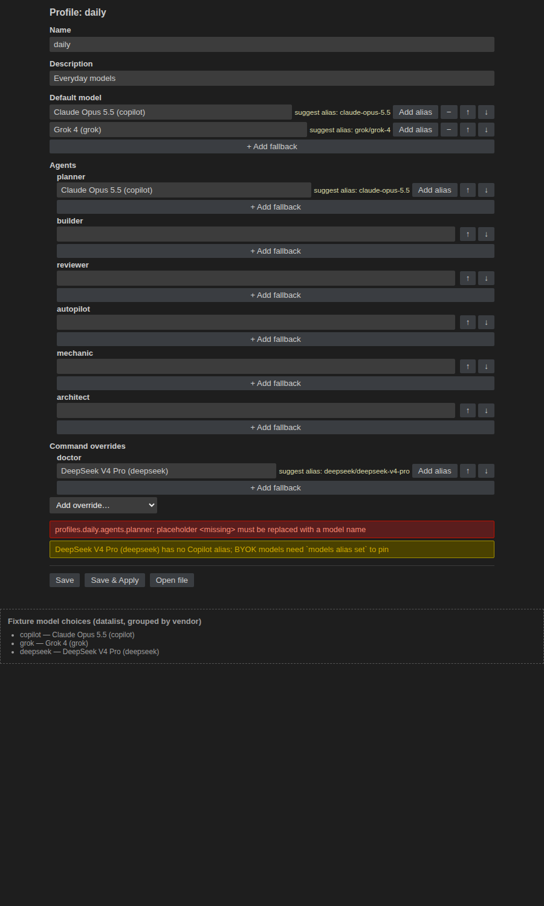
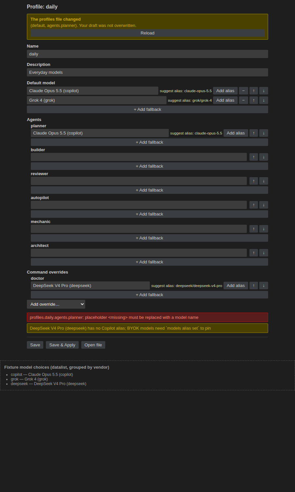

```yaml
status: in-review
branch: feature/model-profile-editor
last-updated: 2026-10-21
next-step: "4.4 fix the post-save refresh when the draft is dirty (review request-changes)"
initiative: "model-profile-manager"
artifact-pr: "#63"
```

## Phase 1: CLI read fields

- [x] 1.1 In `scripts/model-profiles.mjs`, export `isPinnablePrompt(prompt, agentNames)` with the exact rule `resolveTargets` applies (a prompt is pinnable unless its `agent:` is a custom agent known by `name:`), and make `resolveTargets` call it. In `scripts/agento.mjs` `models list`, add top-level `pinnable: { agents: [<the six AGENT_ALIASES keys>], prompts: [<sorted pinnable command names>] }` from `state.layout`, reported even with no profiles file. Add `scripts/model-profiles.test.mjs` cases for `isPinnablePrompt` (absent `agent:`, `agent: "agent"`, a known custom agent, an unknown agent name) and `scripts/agento.test.mjs` cases asserting that `pinnable.prompts` equals the set of prompts that `models update --dry-run` accepts as `prompts.<command>` without the custom-agent error, and that existing `list` fields are unchanged — verify: `node --test scripts/model-profiles.test.mjs scripts/agento.test.mjs` exits 0 with the new cases passing
- [x] 1.2 Add `body` (the stored profile object as written, `{}` for an empty profile) to `models show <name>`, with a `scripts/agento.test.mjs` case that round-trips `update` stdin → `show` `body`. Document `pinnable` and `body` in `docs/model-profiles.md` `## Editing profiles`, then run `cd extension && npm run copy-cli` — verify: `node --test scripts/agento.test.mjs tests/extension-bundle.test.mjs` exits 0

## Phase 2: CLI client stdin and arg helpers

- [x] 2.1 In `extension/src/cliClient.ts`, add `input?: string` to `CliRunOptions`. `run` writes it to the child's stdin and ends the stream, and closes stdin immediately when `input` is unset. Extend `extension/test/unit/cliClient.test.ts` with a fixture script that echoes stdin, asserting delivery, and a no-input case that returns promptly — verify: `cd extension && npm run test:unit` exits 0 with the new tests passing
- [x] 2.2 In `extension/src/modelProfiles.ts`, add `updateProfileArgs(name, { dryRun, expect })` and `aliasSetArgs(picker, id, expect)`, and extend `summarizeModelsResult` for the `update` (including `reapply`), `rename`, and `alias` results. Extend `extension/test/unit/modelProfiles.test.ts` — verify: `cd extension && npm run test:unit` exits 0

## Phase 3: Pure editor model and HTML

- [x] 3.1 Add `extension/src/profileEditorModel.ts` (no `vscode` import), per plan.md `## Approach` item 3:
  - `profileToForm` and `formToProfile` (one-item list ↔ string, empty fields omitted, stable key order, unknown keys preserved with a notice);
  - `modelChoices` (vendor-grouped, `<name> (<vendor>)`, sorted, de-duplicated);
  - `suggestAlias` and `aliasStatus`;
  - `parseWebviewMessage`, a closed schema for `ready`, `change`, `validate`, `save`, `saveAndApply`, `addAlias`, `reload`, and `openFile`;
  - `diffFields` and `validateRename`.

  Add `extension/test/unit/profileEditorModel.test.ts` covering every branch, including malformed and unknown messages — verify: `cd extension && npm run test:unit` exits 0 with the new tests passing
- [x] 3.2 Add `extension/src/profileEditorHtml.ts` with `makeNonce()` (`crypto.randomBytes`) and `renderEditorHtml({ nonce, cspSource, scriptUri, styleUri, title })`. The CSP is `default-src 'none'; style-src ${cspSource}; script-src 'nonce-${nonce}'; img-src ${cspSource} data:; font-src ${cspSource}`, with one nonce'd script tag, no inline handlers, and no remote URLs. Add `extension/test/unit/profileEditorHtml.test.ts` asserting each property — verify: `cd extension && npm run test:unit` exits 0 with the new tests passing

## Phase 4: Webview, panel host, and commands

- [x] 4.1 Add `extension/media/profileEditor.js` (`// @ts-check`, plain browser JS) and `extension/media/profileEditor.css` (VS Code theme variables), per plan.md `## Approach` item 4. The script:
  - renders the form from `state`;
  - shows name, description, default, the six agent fields, and the "Command overrides" section with **Add override** over the unused `pinnable.prompts`;
  - gives each value a `<datalist>`-backed input with fallback-list add, remove, and reorder controls;
  - shows the empty-model-list hint, inline errors and warnings, the alias status with **Add alias**, and the conflict banner with only **Reload**;
  - keeps the draft and base hash in `vscode.setState`, posts `change` with the dirty flag, and debounces (about 400 ms) `validate`;
  - posts only schema-conforming messages.

  Verify: `cd extension && npm run build && npm run typecheck` exits 0, and `node --check media/profileEditor.js` exits 0
- [x] 4.2 Add `extension/src/profileEditorPanel.ts` (`ProfileEditorPanels`), per plan.md `## Approach` item 5:
  - one panel per profile, revealed if already open, with `enableScripts`, `localResourceRoots` set to `media/`, and a `● ` dirty title prefix;
  - load from `models show` and `models list` plus a replaceable `ModelSource` (default `vscode.lm.selectChatModels()`);
  - `validate` runs `update --dry-run` with stdin;
  - `save` runs a dry run, then `rename --expect` if the name changed (re-keying the panel), then `update --expect` with stdin; it then reloads the tree view and shows `reapply`;
  - `saveAndApply` saves, then calls `runModelsSelection`;
  - a `conflict` posts `diffFields` and only Reload clears it;
  - `addAlias` runs `alias set --expect` and adopts the new hash;
  - panels that are not dirty reload on the profiles-file watcher, and a deleted profile shows a "deleted elsewhere" state;
  - `handleMessage` is exported, and every inbound message goes through `parseWebviewMessage`.

  Verify: `cd extension && npm run build && npm run typecheck && npm run test:unit` exits 0
- [x] 4.3 Wire the commands in `extension/src/extension.ts` and `extension/package.json`:
  - `agento.modelProfiles.edit` opens the editor;
  - the new palette command `agento.editModelProfile` (*Agento: Edit Model Profile*, category Agento) shows a quick pick of profiles, with the missing-plugin-root and no-file handling;
  - `new` and `duplicate` open the editor on the created profile;
  - the panel's `openFile` reuses `openProfilesFile`;
  - `ExtensionApi` gains `profileEditor` (open panel names, `handleMessage`, last posted state per panel) and `setProfileEditorModelSource`;
  - panels are disposed of with the extension.

  Verify: `cd extension && npm run build && npm run typecheck && npm run test:unit` exits 0, and `git diff origin/main -- extension/package.json` shows only the new command and its palette entry
- [ ] 4.4 (added 2026-10-21) Fix the post-save refresh in `extension/src/profileEditorPanel.ts` `save()`: when the webview has reported a dirty draft (`change { dirty: true }`, which `media/profileEditor.js` posts on every keystroke), the `load(currentName)` after a successful `update` returns early on `state.dirty` (line 160), so the panel never re-posts `state`, keeps the stale hash and the `●` marker, and the next Save answers a spurious `conflict` (review.md, Finding 1). Clear `state.dirty` / bump `loadToken` (or adopt `updateJson.profilesFile.hash`) before the reload so the panel posts the new state and hash — verify: `cd extension && npm run build && npm run typecheck && npm run test:unit` exits 0, and the sequence `change dirty:true → save → change dirty:true → save` through `profileEditor.handleMessage` writes both saves with the posted `state.hash` equal to `models show` `profilesFile.hash` and no `conflict`
- [ ] 4.5 (added 2026-10-21) Fix the `addAlias` refresh contract between `extension/src/profileEditorPanel.ts` (line 329 posts `{ type: "state", keepDraft: true, name, copilotModels, hash }`) and `media/profileEditor.js` `receiveState` (line 412 assigns the partial message to `state`, then `renderForm()` reads `state.unknownKeys.length` at line 232 and throws `TypeError`, leaving the form blank — review.md, Finding 2). Either post the full state with `keepDraft`, or merge the partial refresh into the existing `state` in the webview — verify: `node --check media/profileEditor.js` exits 0 and the harness (or a unit-level DOM check) posts the `keepDraft` state after the initial `state` with no uncaught error and the form inputs still rendered

## Phase 5: Electron coverage

- [x] 5.1 In the in-repo scenario of `extension/test/electron/suite.ts`, add `agento.editModelProfile` to the registration assertions. Assert that `profilesFile.path` is under the temp `AGENTO_CONFIG_HOME` before any write, install a stubbed `ModelSource` (one Copilot and one BYOK model), and drive through the registered commands and `profileEditor.handleMessage`:
  1. row Edit opens one panel, and a second Edit reveals the same one;
  2. load posts `state` with `pinnable` and the stubbed choices;
  3. `validate` with a custom-agent command override reports the CLI error;
  4. `save` writes the body, matching `models show` `body`;
  5. a rename plus `save` re-keys the panel;
  6. `saveAndApply` changes the clone's `model:` lines;
  7. a stale hash (the file changed through a direct CLI call) posts `conflict` with the changed fields and leaves the file untouched;
  8. `addAlias` writes `copilotModels`;
  9. New and Duplicate open the editor on the created profile;
  10. *Agento: Edit Model Profile* opens through the stubbed quick pick.

  Verify: `cd extension && npm run test:electron` (under `xvfb-run -a` where installed, else on the desktop `DISPLAY`) exits 0 with all four scenarios passing and the in-repo log naming the profile-editor checks, and `git status --porcelain --untracked-files=all` is empty afterwards
- [ ] 5.2 (added 2026-10-21) Cover the real dirty-then-save flow in `extension/test/electron/suite.ts` `assertModelProfileEditor`: before the saves in checks 4–6 post `change { form, dirty: true }` (as the webview does), then assert that the message posted after each successful save is `state` whose `hash` equals `models show` `profilesFile.hash`, and that a following edit + save succeeds without `conflict`; also assert `addAlias` leaves the panel usable (the posted refresh carries everything `receiveState` renders) — verify: `cd extension && npm run test:electron` exits 0 with the in-repo scenario passing, and the new assertions fail against the pre-4.4/4.5 code

## Phase 6: Visual evidence and packaging

- [x] 6.1 Add `extension/test/webview/profileEditorHarness.html`. It loads `../../media/profileEditor.js` and `.css` with a stubbed `acquireVsCodeApi` and stub theme variables, and posts a fixture `state` covering an error, a warning, a fallback list, a command override, an alias suggestion, and (with `?conflict=1`) the conflict banner. It is not packaged (`test/**` is in `.vscodeignore`) — verify: `cd extension && npm run package` succeeds and `unzip -l agento-*.vsix` does not list `test/webview`
- [x] 6.2 Serve `extension/` with `python3 -m http.server 3177 --bind 127.0.0.1`, render `test/webview/profileEditorHarness.html` and `?conflict=1` in a headless browser, and save `evidence/step-6-2-editor-form.png` and `evidence/step-6-2-editor-conflict.png` in this slug directory (companion half), linked from this line. Stop the server afterwards — verify: local:3177, both screenshots show the grouped model choices, a fallback list, a command override, inline errors and warnings, the alias suggestion, and the conflict banner with only Reload; the browser console shows no CSP violations — evidence:  
- [x] 6.3 Confirm that the VSIX ships the webview assets — verify: `cd extension && npm run package` succeeds, `unzip -l agento-*.vsix` lists `extension/media/profileEditor.js` and `extension/media/profileEditor.css`, `npm run test:vsix` exits 0, and the built `.vsix` is removed afterwards so the tree stays clean

## Phase 7: Docs, release, and gate

- [x] 7.1 Document the editor:
  - `docs/model-profiles.md` `## Editing profiles`: the editor as the UI for `update`/`rename`/`alias set`;
  - `docs/extension.md` `## Model profiles`: the editor, Save / Save & Apply, dry-run feedback, conflicts and Reload, aliases, free text and the empty-model-list hint, and drafts being lost on close;
  - `extension/README.md` `## Model Profiles`: the editor and the *Agento: Edit Model Profile* entry in the Commands list.

  Write only canonical `/agento <name>` command spellings — verify: `node --test tests/customizations.test.mjs` exits 0
- [x] 7.2 Bump the version to `0.11.0` in `.claude-plugin/plugin.json`, `package.json`, `extension/package.json`, and `extension/package-lock.json` (both fields, via `npm version 0.11.0 --no-git-tag-version` in `extension/`), and add a `## 0.11.0 (unreleased)` **Added** entry for the model profile editor and the `pinnable`/`body` CLI fields at the top of `CHANGELOG.md` — verify: `node --test 'scripts/**/*.test.mjs' 'tests/**/*.test.mjs'` exits 0
- [x] 7.3 Full gate (§5), each run with its status captured:
  - `/tmp/shellcheck-v0.10.0/shellcheck scripts/hooks/*.sh scripts/wait-for-checks.sh` (download v0.10.0 if absent);
  - `node --test 'scripts/**/*.test.mjs' 'tests/**/*.test.mjs'`;
  - the five guard smoke replays from AGENTS.md;
  - `cd extension && npm ci && npm run build && npm run typecheck && npm run test:unit && npm run test:electron`.

  Counts (2026-10-21): shellcheck exit 0 / 0 findings; root tests 612/612 pass; guard replays 5/5 exit 0; extension unit 201/201 pass; electron 4/4 scenarios pass; both halves clean — verify: shellcheck exits 0 with no findings, at least 609 root tests plus the new ones pass, every guard replay passes, at least 183 unit tests plus the new ones pass, all four electron scenarios pass, and `git status --porcelain --untracked-files=all` is empty in both halves
