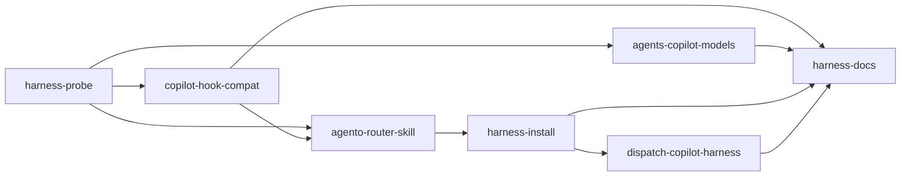

```yaml
initiative: copilot-harness
created: 2026-10-13
last-updated: 2026-10-13
```

# Copilot harness: Agento commands, agents, and hooks on the VS Code Agent Host

## Goal

Agento works when the chat's Session Target is **Copilot** (the Agent Host harness,
built on the GitHub Copilot SDK), not only **Local**. After this initiative:

- `/agento <name> [args]` works in a Copilot session through a single `agento` router
  skill, with the exact canonical spelling. The router hands each command to its
  custom agent as a subagent, so model pins still apply.
- The delivery guard and the `Agento CLI:` session context fire in Copilot sessions
  as they do in Local ones. No Copilot session runs unguarded.
- `agento.mjs harness install|status` and a `harness` check in doctor install and
  verify the router, and the extension's dashboard dispatch works in both harnesses.
- Local sessions keep working unchanged until VS Code removes the Local harness.

## Decisions

Decisions carried in the brief (verbatim):

1. Full Copilot-harness support. No "default to Local" stopgap.
2. A single router skill named `agento` keeps the canonical spelling `/agento <name> [args]` exactly. No per-command /agento:<name> skills.
3. The router hands each command to its command file's `agent:` custom agent as a subagent, so agent model pins still apply. It runs the command inline when `agent:` is missing or "agent". Fallback, only if the spike proves it necessary and the user approves it: interactive or orchestrating agents (Planner, Architect, Mechanic, Autopilot) run inline by following their agent file's body.
4. commands/*.md stays the single source the router reads. .github/prompts/ stays unchanged until Local is removed.

Clarifying questions asked with the ask-questions tool on 2026-10-13:

- **Q: How should the spike ship as a member feature?** A: Own feature: findings
  committed as docs/copilot-harness.md + a reproducible probe script/fixtures.
- **Q: Target size of a member feature?** A: Small–medium: one concern each (~5–8
  features).
- **Q: Should the VS Code extension also offer/perform the harness install (e.g. a
  Session & Doctor action), or CLI + doctor only?** A: CLI + doctor check only;
  extension just surfaces the doctor result.
- **Q: Must every member keep the Local harness fully working (no regression) until
  Local is removed?** A: Yes — every member verifies Local too.

## Research

Skills consulted: agent-customization (built-in VS Code skill: skill, agent, and hook
file formats and locations). The Agento repository has no `.agents/skills/` directory
and its AGENTS.md has no skills table (verified 2026-10-13 on `main` `15e67eb`).

### Harness behavior (VS Code and GitHub docs, edited 2026-10-07; unverified until `harness-probe`)

- **Prompt files.** The Copilot harness does not load `*.prompt.md`. Prompt files are
  deprecated for Agent Host, and the Local harness "will be removed in a future
  release". The documented conversion to a skill sets `disable-model-invocation: true`
  and drops `agent:`, `model:`, and `tools:`.
- **What the Copilot harness loads.** `.github/instructions`, `AGENTS.md`,
  `.github/agents`, skills from `.github/skills`, `.agents/skills`, `~/.copilot/skills`,
  `~/.agents/skills`, and plugin `skills/`, plus hooks and `.mcp.json`. Plugin skills
  are prefixed `/<plugin>:<skill>`, which is why the router has to be a user-level
  skill to keep `/agento <name>`.
- **Plugin inventories.** Agent Host plugins (`/plugin`, `~/.copilot/installed-plugins`)
  are tracked separately from `chat.pluginLocations` and the Customizations editor.
  The legacy Copilot plugin manifest accepts `agents`, `skills`, `commands`, and
  `hooks` path fields.
- **Hooks (GitHub Copilot hooks reference).**
  - Under the PascalCase event `PreToolUse`, input is snake_case (`tool_name`,
    `tool_input`) with Claude tool names: `bash` maps to `Bash`, `create` to `Write`,
    `edit`/`apply_patch` to `Edit`, `view` to `Read`, `task` to `Agent`.
  - The decision is read from top-level `permissionDecision` and
    `permissionDecisionReason`.
  - `sessionStart` output is read from top-level `additionalContext`.
  - A preToolUse command hook that crashes or exits 2 fails closed; a timeout fails
    open.
  - A malformed item is dropped; a bad `version` rejects the whole file.
- **Subagents and agents.** Copilot custom agents accept tool aliases (`execute`,
  `read`, `edit`, `search`, `agent`, `web`). `browser` and `vscode/askQuestions` are
  VS Code-specific. Model ids in the Copilot runtime may differ from the VS Code
  picker's `Name (vendor)` form.
- **Handoff and default target.** Handoff to another harness starts only from a
  Local session. No documented setting picks a default Session Target.

### Agento surfaces affected (code, `main` `15e67eb`)

- **Commands.** 25 files in `commands/*.md`, each a byte mirror of
  `.github/prompts/*.prompt.md` (parity is enforced in `tests/customizations.test.mjs`):
  - 10 name a custom agent: `ap`, `build-feature`, `build-issue`, `extend-copilot`,
    `fix-copilot`, `new-feature`, `new-initiative`, `new-issue`, `review-feature`,
    `review-issue`;
  - 11 use `agent: "agent"`;
  - 4 have no `agent:`: `agento-init`, `close-session`, `install-skills`,
    `start-session`.
- **Agents.** 6 in `.github/agents/`: Planner, Builder, Reviewer, Autopilot,
  Architect, Mechanic. Their `tools:` lists include `browser` and
  `vscode/askQuestions`, and their `model:` pins are VS Code picker names (for example
  `Claude Opus 5.5 (copilot)`, `DeepSeek V4 Pro (deepseek)`), rewritten by
  `agento.mjs models` through a git clean/smudge filter.
- **Plugin manifest.** `.claude-plugin/plugin.json` (version `0.7.0`) declares
  `agents: .github/agents`, `commands: commands`, and `hooks: ./hooks/hooks.json`.
  `hooks/hooks.json` uses `${CLAUDE_PLUGIN_ROOT}`. The workspace-mode wiring is
  `.github/hooks/delivery-guard.json` and `session-start.json` (PascalCase, no
  `version`). There is no `skills/` directory yet.
- **Delivery guard.** In `scripts/hooks/delivery-guard.mjs`:
  - `decide()` (L191–L203) reads `tool_name || toolName` and `tool_input || toolInput`,
    and only when the input is already an object. A `toolArgs` JSON string is
    ignored.
  - The file path is taken from `filePath`, `file_path`, `path`, or `uri`. An
    `apply_patch` patch body is not parsed for paths.
  - `WRITE_TOOL` (L24) matches `edit|create|write|replace|patch|apply|insert|notebook`.
  - Output (L422) is only `{ hookSpecificOutput: { permissionDecision, … } }`.
- **Session context.** `scripts/hooks/session-context.mjs` emits only
  `{ hookSpecificOutput: { additionalContext } }` (L152). Under the Copilot schema
  both hooks are therefore likely no-ops: an unguarded session with no `Agento CLI:`
  line.
- **Guard replay.** `scripts/hooks/replay-guard.sh` (L57–L59) builds Local payloads
  (`tool_name: "run_in_terminal"`) and reads `hookSpecificOutput.permissionDecision`.
- **Extension.** `extension/src/commandDispatcher.ts` `chatOpenOptions` calls
  `workbench.action.chat.open` with `{ query, mode, attachFiles }`. `mode` comes from
  the `commands/<name>.md` `agent:` and the plugin root from `agento.pluginRoot` or
  `chat.pluginLocations` (`extension/src/modelProfiles.ts` `resolvePluginRoot`).
  `extension/cli/` is a byte copy of `scripts/` (`npm run copy-cli`).
- **Second plugin checkout.** A second checkout, `/home/david/DP/agento-plugin`, also
  names `agento-docs` as its companion (session warning `companion-anchor`). The
  harness install must pick one plugin root explicitly.

## Features

### harness-probe

- Summary: Verify the Copilot harness's real behavior with a reproducible probe and commit the findings as docs/copilot-harness.md.
- Brief: Spike, which blocks the rest: chat.pluginLocations vs `copilot plugin install` loading; discovery of .github/hooks/*.json and plugin hooks/hooks.json with ${CLAUDE_PLUGIN_ROOT}; actual hook input payloads and honored output shapes; whether ~/.copilot/skills/agento resolves as /agento with arguments, including through a symlink; subagent ask-user, nesting, model pins and model-name format; workbench.action.chat.open {query, mode, attachFiles} in a Copilot session.
- Requires: none
- Recommended after: none
- Wave: 1
- Size: M
- Independence: Ships a standalone probe (a payload-logging hook script, a throwaway test skill and agent, fixtures of captured payloads) plus docs/copilot-harness.md. It changes no runtime behavior, and every later member reads its findings instead of guessing.

### copilot-hook-compat

- Summary: Make the delivery guard and session context work under the Copilot hook schema without regressing Local.
- Brief: Hooks: each hook emits one JSON object carrying both shapes (top-level Copilot fields plus hookSpecificOutput for Local); decide() normalizes bash/Bash, edit/create/Write (file path in `path`), and apply_patch (patch-text paths for hook-file self-protection) and parses toolArgs JSON strings; hook wiring files change only if the spike requires it (approval-gated); a Copilot-format guard fixture set and replay-guard.sh support for it.
- Requires: harness-probe
- Recommended after: none
- Wave: 2
- Size: M
- Independence: Pure hook-layer change verified by replay fixtures in both formats. Copilot sessions become guarded even before any command works there, and Local output stays the same, because Local reads the hookSpecificOutput it reads today.

### agents-copilot-models

- Summary: Make the six custom agents load correctly in the Copilot harness, with tool lists and model pins it understands.
- Brief: Agents and models: check the tools: lists in .github/agents against Copilot tool aliases (browser and vscode/askQuestions may be ignored); if the Copilot harness needs a different model id format, make `agento.mjs models` write it.
- Requires: harness-probe
- Recommended after: copilot-hook-compat
- Wave: 2
- Size: S
- Independence: Touches only `.github/agents/*.agent.md` frontmatter and the `models` subcommand, verified by selecting each agent in a Copilot session and by the models tests. Useful on its own whenever a user selects an Agento agent from the picker.

### agento-router-skill

- Summary: Add the `agento` router skill so `/agento <name> [args]` runs the matching commands/<name>.md in a Copilot session.
- Brief: Router skill: skills/agento/SKILL.md in the clone with name agento, argument-hint "<command> [args]", disable-model-invocation: true; it parses the command name, applies the agento-core redirect rule, resolves commands/<name>.md, and delegates to the `agent:` custom agent as a subagent or runs inline (decision 3); tests/customizations.test.mjs asserts the router skill's frontmatter and name rules and that every commands/*.md `agent:` names an existing agent or "agent".
- Requires: harness-probe, copilot-hook-compat
- Recommended after: agents-copilot-models
- Wave: 3
- Size: M
- Independence: Ships one skill directory plus its tests. It works as soon as someone puts it in a user skill location by hand (the probe's documented manual step), and commands/*.md and Local prompts are unchanged.

### harness-install

- Summary: Add `agento.mjs harness install|status` and a doctor `harness` check that install and verify the router skill for Copilot sessions.
- Brief: `agento.mjs harness install|status`, which symlinks ~/.copilot/skills/agento to the clone, plus a doctor `harness` check; edit scripts/, then run `cd extension && npm run copy-cli`; the extension only surfaces the doctor result (no install action).
- Requires: agento-router-skill
- Recommended after: none
- Wave: 4
- Size: S
- Independence: A self-contained CLI subcommand and doctor check with node:test coverage. The Session & Doctor panel shows the new check through the existing doctor rendering, with no extension code beyond copy-cli.

### dispatch-copilot-harness

- Summary: Make the extension's dashboard and cross-window dispatch submit Agento commands correctly in Copilot sessions.
- Brief: Extension: adjust chatOpenOptions in extension/src/commandDispatcher.ts only if the spike shows a gap, and update its unit tests; verification includes dashboard dispatch working in a Copilot session.
- Requires: harness-install
- Recommended after: agents-copilot-models
- Wave: 5
- Size: S
- Independence: Limited to the extension's dispatch path and its unit tests. If the spike finds no gap, it ships as a verification-only delivery whose evidence is a recorded Copilot-session dispatch.

### harness-docs

- Summary: Document Copilot-harness use end to end, bump the plugin version, and run the full two-harness acceptance in soshiki.
- Brief: Tests and docs: update docs/install.md, hooks.md, architecture.md, extension.md, and commands.md; bump the version in .claude-plugin/plugin.json and add a CHANGELOG entry; verification for the initiative overall (full test suites and replays, and the manual Copilot-session and Local-session checks in soshiki).
- Requires: copilot-hook-compat, agents-copilot-models, harness-install, dispatch-copilot-harness
- Recommended after: none
- Wave: 6
- Size: S
- Independence: Documentation, release metadata, and the cross-member acceptance run. It changes no behavior, so it can only land once everything it describes has shipped.

## Recommended order

- **Wave 1 — harness-probe.** Every design choice below depends on observed harness
  behavior: hook discovery, payloads, output shapes, skill resolution, subagent
  limits, and dispatch. The probe turns the doc claims into recorded facts.
- **Wave 2 — copilot-hook-compat and agents-copilot-models in parallel.** The hooks
  member closes the safety gap first, so no Copilot session runs unguarded once
  commands work there. Agent frontmatter is independent of the hooks and only needs
  the probe's tool and model findings.
- **Wave 3 — agento-router-skill.** It needs the hooks shipped (commands must not run
  unguarded) and is best built after the agents load cleanly, since it delegates to
  them.
- **Wave 4 — harness-install.** It needs the skill directory to link to.
- **Wave 5 — dispatch-copilot-harness.** The dashboard submits `/agento …` queries,
  which only resolve once the router is installed.
- **Wave 6 — harness-docs.** Last, per the brief: it documents what shipped and runs
  the full two-harness acceptance.



## Risks

- **The docs may not match the shipped harness.** Mitigation: harness-probe records
  observed payloads as fixtures, and later members build against those fixtures, not
  the prose.
- **Subagents may not be able to ask the user or nest** (Planner, Architect, Mechanic,
  Autopilot). Mitigation: decision 3's inline fallback, used only with the user's
  approval and recorded in agento-router-skill's plan.
- **A dual-shape hook output could confuse one harness.** Mitigation: both replay
  formats, plus a manual Local and Copilot check in every hook-touching member, per
  the Local-parity decision.
- **A preToolUse crash fails closed and blocks every tool.** Mitigation: the guard
  keeps its no-node early exit 0 and wraps normalization so malformed input yields
  `allow`, never a crash.
- **A plugin clone registered through chat.pluginLocations may not load in Agent
  Host.** Mitigation: the probe decides between documenting `copilot plugin install`
  from a local directory marketplace and making the hooks/router self-sufficient. The
  harness-install member follows that finding.
- **Two plugin checkouts (`agento`, `agento-plugin`) could both claim the router.**
  Mitigation: `harness install` takes an explicit plugin root and `harness status`
  reports which clone the symlink points at.
- **Model pins could silently fall back** if the Copilot runtime rejects the picker
  names. Mitigation: agents-copilot-models verifies each agent's effective model in a
  Copilot session, not just its frontmatter.

## Out of scope

- Claude and Codex harnesses.
- Deleting `.github/prompts/` or the `commands/` mirrors.
- Per-command plugin skills (`/agento:<name>`).
- Changes to `agento-init` scaffolding for target repositories.
- A "default to Local" switch or any other stopgap.
- An install action in the VS Code extension (it only surfaces the doctor result).

## Definition of done

- In a Copilot session in soshiki:
  - `/agento delivery-status` prints its receipt;
  - the `Agento CLI:` context line is present;
  - an agent-typed `git push origin main` is denied;
  - editing `.github/hooks/x.json` asks for approval;
  - `/agento new-feature` runs in the Planner;
  - dashboard dispatch works.
- The same checks pass in a Local session.
- `node --test 'scripts/**/*.test.mjs' 'tests/**/*.test.mjs'`, both existing guard
  replays plus the Copilot replay, `shellcheck`, and `cd extension && npm run
  test:unit` all pass.
- `agento.mjs doctor` reports the `harness` check `ok` on a machine where `agento.mjs
  harness install` was run.
- docs/install.md, hooks.md, architecture.md, extension.md, commands.md, and
  docs/copilot-harness.md describe both harnesses.
- `.claude-plugin/plugin.json` is bumped and CHANGELOG.md has an entry.
- Every member feature has `status: complete`.
