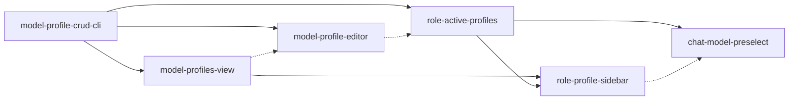

```yaml
initiative: model-profile-manager
created: 2026-10-21
last-updated: 2026-10-21
```

# Model profile manager: CLI CRUD, a sidebar switcher and editor, and per-window-role active profiles

## Goal

Managing model profiles moves out of hand-editing `~/.config/agento/model-profiles.json`
and into the Agento sidebar. After this initiative:

- Profiles can be created, edited, duplicated, renamed, and deleted from the CLI
  (`agento.mjs models …`), from `/agento models`, and from the sidebar. The CLI stays
  the only writer of the profiles file and validates every write.
- A **Model Profiles** view in the Agento sidebar lists every profile and switches
  between them with one click.
- A form-based editor creates and edits profiles: description, default, per-agent
  and per-command pins, and fallback lists. Its model choices come from the models
  VS Code knows about, and free text stays allowed.
- Primary windows and secondary windows (plan, build, freehand) each have their own
  active profile, which can be turned on or off per role. Switching in a secondary
  window does not change the primary window.
- Commands the extension launches into chat start on the profile's model for that
  window role. This works around the Copilot-harness limitation where a directly
  selected agent ignores its `model:` pin.

## Decisions

The Architect asked these questions with the ask-questions tool on 2026-10-21. The
user's answers are below verbatim; each notes whether it was the recommended option.

- **Q1: What does "turn profiles on and off in primary and secondary windows" mean?**
  A: `per-role-active`: "Each window role (primary vs. secondary build/plan/freehand)
  has its own active profile; switching in a secondary window doesn't change the
  primary" (recommended).
- **Q2: How should create/edit work in the UI?** A: `webview-form`: "Webview form
  editor: per-agent/per-command model dropdowns populated from the models VS Code
  knows about; saves through new CLI verbs (CLI stays the only writer)" (recommended).
- **Q3: Where in the sidebar?** A: `tree-view`: "New 'Model Profiles' view in the
  Agento container: one row per profile, active marker per window role, inline
  actions (switch, edit, duplicate, delete) + New Profile" (recommended).
- **Q4: What should ship first?** A: `cli-first`: "CLI CRUD verbs
  (create/update/delete/rename, validated) first, then the sidebar view + one-click
  switching, then the editor, then per-window behavior" (recommended).
- **Q5: Which of these are explicitly OUT of scope?** A: only "Team-shared profiles
  committed to a repo". The user unchecked the other four defaults: per-project /
  per-repository profiles, import/export, cost/usage estimation per profile, and
  changing the Copilot-harness direct-selection limitation. The recommended answer
  was all five out.
- **Follow-up (a): Scope confirmation for the four unchecked items.** A:
  `core-plus-harness`: "Only the Copilot-harness workaround is in; per-project,
  import/export, cost estimation stay out (follow-ups)" (recommended).
- **Follow-up (b): Per-role granularity.** A: `primary-secondary`: "Two buckets:
  primary and secondary (plan/build/freehand share one)" (recommended).

## Research

Skills consulted: none — no matching domain. The repository has no AGENTS.md skills
table and no `.agents/skills/`. Both test suites use `node:test`, so the installed
vitest skill does not apply.

- **Profiles file and CLI.** `scripts/model-profiles.mjs` owns the path, validation,
  resolution, and active detection: `profilesFile`, `parseProfiles`, `errorsFor`,
  `resolveTargets`, `detectActive`, and the warning helpers. The file is found at
  `AGENTO_CONFIG_HOME`, else `$XDG_CONFIG_HOME/agento`, else `~/.config/agento`.
  Unknown top-level or profile keys are errors. Agent aliases are fixed: `planner`,
  `builder`, `reviewer`, `autopilot`, `mechanic`, `architect`.
  `scripts/agento.mjs` `case "models"` (around lines 4697–4814) dispatches `list`,
  `pins`, `show`, `apply`, `adopt`, `clear`, and `init`. Only `init` writes the
  profiles file, by copying `templates/model-profiles.json`. Results are JSON
  documents with `status`, `verb`, `profilesFile`, `active`, `filter`, `dirty`, and
  `hint`. Operational findings (`not-found`, `invalid`, `dirty`, `worktree`,
  `git-too-old`) exit 3. New mutation verbs belong in the same dispatch block, with
  their write helpers next to `parseProfiles`.
- **Active state is derived, clone-wide.** `modelsState()` (around
  `scripts/agento.mjs:3605`) reads every agent and prompt file's `model:` lines.
  `detectActive()` (`scripts/model-profiles.mjs:347`) returns a profile name,
  `custom`, or `null`. The pin filter (`scripts/model-filter.mjs`) is the transport
  that keeps pins out of commits. There is no per-window or per-role concept:
  `docs/model-profiles.md` "Limits" says one profile is active per clone,
  machine-wide.
- **Window roles.** `scripts/session-state.mjs` derives `primary`, `plan`, `build`,
  `freehand`, and `unmanaged` (`deriveRole`, `classifyByPath`, `roleForManaged`,
  around lines 128–192). The extension reads the role from the CLI session record
  (`extension/src/windowGate.ts`).
- **Where a model actually takes effect.** The router (`skills/agento/SKILL.md`
  around lines 61–66) and the Autopilot (`.github/agents/delivery-autopilot.agent.md`
  around lines 68–76) run `models pins` and pass `subagentModel` (Local
  `runSubagent`) or `copilotModel` (Copilot `task`) for the Builder and Reviewer.
  `models pins` (around `scripts/agento.mjs:3715`) reads the current file pins and
  has no `--role`. Commands run inline through the router use the session's model.
  In the Copilot harness, a directly selected agent ignores its `model:` pin
  (`docs/model-profiles.md` "Subagents and handoffs"). A per-role profile therefore
  takes effect through dispatch-time model passing, not through the shared file
  pins.
- **Extension.** `agento.selectModelProfile` (`extension/src/extension.ts:522–555`,
  `extension/src/modelProfiles.ts`) is a quick pick over `models list` that runs
  `models apply` or `models clear`. Three tree views (deliveries, initiatives, and
  session doctor) are registered at `extension.ts:574–576`. The only webview is the
  window banner (`windowBannerProvider.ts`). It has scripts disabled and talks to the
  host through `command:` URIs. The model profile editor would be the first webview
  with scripts and `postMessage`. Chat dispatch
  (`extension/src/commandDispatcher.ts:35–60`) passes `{ query, mode?, attachFiles? }`
  to `workbench.action.chat.open` and no model selection. The extension does not
  use `vscode.lm` anywhere.
- **Tests and copies.** Extension unit tests run under `node --test` on
  `out/test/unit/**`, and electron activation tests live under
  `extension/test/electron`. `extension/cli/` is a generated byte copy of
  `scripts/` (`npm run copy-cli`). `tests/customizations.test.mjs` forbids committed
  `model:` lines. It also requires every command's `Needs:` line to agree with
  `COMMAND_NEEDS` in `scripts/agento.mjs` (`models: ["terminal"]`).
- **Doctor.** The informational `model-profile` check (around
  `scripts/agento.mjs:947–1011`) reports `ok` or `warn` for profiles-file validity,
  filter health, `custom` pins, and the BYOK-tier, vendor-suffix, and
  Copilot-alias warnings.
- **Docs to keep current.** `docs/model-profiles.md`, `README.md` (command table),
  `extension/README.md`, `docs/extension.md`, and `CHANGELOG.md` (its
  `## <version> (unreleased)` section).

## Features

### model-profile-crud-cli

- Summary: CLI verbs that create, update, duplicate, rename, and delete profiles in the profiles file, validated and written atomically, exposed through `/agento models`.
- Brief: "We should be able create/edit/update delete profiles."
- Requires: none
- Recommended after: none
- Wave: 1
- Size: M
- Independence: Pure CLI work on `scripts/model-profiles.mjs` and the `models` block of `scripts/agento.mjs`. It is usable from a terminal and from `/agento models` before any UI exists, and it changes no pin or filter behavior. Profiles can be managed without hand-editing JSON. Scope: `models create <name> [--from <profile>] [--description <text>]`; `models update <name>` (the full profile object as JSON on stdin, with `--dry-run` for validation only); `models rename <old> <new>`; `models delete <name>`; a way to edit `copilotModels` aliases. Every write validates the whole file first, refuses an invalid file without clobbering it, writes atomically (temp file and rename), keeps the existing formatting stable, and takes an optional `--expect <hash>` so concurrent writers detect a conflict. Deleting or renaming the profile the clone's files currently match is reported clearly, and the plan decides whether that is refused without `--force`. The feature also updates the `/agento models` command file and its mirror, `docs/model-profiles.md`, `README.md`, and `CHANGELOG.md`, runs `npm run copy-cli`, and adds tests.

### model-profiles-view

- Summary: A "Model Profiles" tree view in the Agento sidebar: one row per profile with an applied marker and errors, one-click switching, and New, Duplicate, Rename, Delete, and Clear actions.
- Brief: "I want to make it so we can easily switch between profiles through the UI sidebar."
- Requires: model-profile-crud-cli
- Recommended after: none
- Wave: 2
- Size: M
- Independence: A new `agento.modelProfiles` view that drives the existing `apply`/`clear` verbs and the new CRUD verbs. Switching and lifecycle actions work clone-wide with today's semantics. Until the editor ships, Edit opens the profiles file. Rows show the name, the description, an "applied" badge (`active`), and error and warning badges with tooltips. The view offers inline Apply, context-menu Duplicate, Rename, and Delete (with a modal confirm), and title-bar New Profile (name plus a copy-from pick), Clear, Refresh, and Open profiles file. An empty state offers `models init`. A file watcher on `profilesFile.path` refreshes the view, and it also refreshes after every apply. The existing *Agento: Select Model Profile* quick pick keeps working through the same code path. The feature adds tree-model unit tests and electron coverage that the view registers, and updates `extension/README.md` and `docs/extension.md`.

### model-profile-editor

- Summary: A webview form that creates and edits a profile, with model dropdowns fed by `vscode.lm` and free-text entry. It validates and saves through the CLI.
- Brief: "We should be able create/edit/update delete profiles."
- Requires: model-profile-crud-cli
- Recommended after: model-profiles-view
- Wave: 3
- Size: L
- Independence: A self-contained editor panel, opened by the command *Agento: Edit Model Profile* (and, once the view exists, from its New and Edit actions). It reads profiles through `models show`/`list` and writes only through `models update`/`create`, so it adds no new storage. It is the first script-enabled webview: strict CSP with a nonce, no remote resources, and schema-checked messages. The form edits the name (rename), description, default, the six agent aliases, and the built-in-agent command pins. The CLI exposes which commands can carry their own pin, so the form never hard-codes the list. Each value is a single model or an ordered fallback list. Model choices come from `vscode.lm.selectChatModels()`, mapped to the qualified `<name> (<vendor>)` form, and free text stays allowed. The editor offers the matching `copilotModels` alias when it can be derived. It shows the CLI's validation errors and warnings live (`update --dry-run`), offers Save and Save & Apply, and reloads on an `--expect` conflict.

### role-active-profiles

- Summary: Separate active profiles for primary and secondary (plan/build/freehand) windows, each of which can be turned on or off. The pins the router and Autopilot pass to subagents are resolved for the current window's role.
- Brief: "We should be able to turn certain profiles on and off in primary and secondary windows."
- Requires: model-profile-crud-cli
- Recommended after: model-profiles-view, model-profile-editor
- Wave: 4
- Size: L
- Independence: CLI and instruction work only. It adds a user-level role assignment, separate from the user-authored profiles file unless the plan argues otherwise: `models use <name> --role primary|secondary` and `models use none --role …` (off). `models list` reports `roles: { primary, secondary }`. `models pins [--role <role>]` defaults the role from the session record and resolves every alias from that role's profile. When the role is off, it falls back to today's file pins. Through that, the router (`skills/agento/SKILL.md`) and the Autopilot dispatch Builder and Reviewer subagents on the window role's models, with no change to their call shape. The shared file pins become the primary role's layer: `use --role primary` applies the profile to the clone files. A secondary profile takes effect through dispatch-time models, and the docs say so. Rename and delete keep role assignments consistent. Doctor's `model-profile` check reports each role's assignment and a dangling one. This is shippable without UI because terminal and `/agento models` users get per-role behavior immediately.

### role-profile-sidebar

- Summary: The Model Profiles view and the window banner show and switch the primary and secondary active profiles, with on and off toggles per role.
- Brief: "We should be able to turn certain profiles on and off in primary and secondary windows" and "easily switch between profiles through the UI sidebar."
- Requires: model-profiles-view, role-active-profiles
- Recommended after: none
- Wave: 5
- Size: M
- Independence: Pure extension presentation over the `models use`/`list` role data. Each profile row carries `primary` and `secondary` badges. Actions are "Use in primary windows", "Use in secondary windows", and "Turn off for primary/secondary". By default, the row action in a window switches that window's own role. The window banner names the profile in effect for the current window. A watcher on the role state refreshes every open window of the affected role. Adds unit tests and doc updates.

### chat-model-preselect

- Summary: Commands the extension dispatches into chat open on the model the window role's profile assigns to that command or agent. This works around the Copilot harness ignoring `model:` pins on directly selected agents.
- Brief: "We should be able to turn certain profiles on and off in primary and secondary windows" (Q5 follow-up: the Copilot-harness workaround is in scope).
- Requires: role-active-profiles
- Recommended after: role-profile-sidebar
- Wave: 5
- Size: M
- Independence: Touches only the extension dispatch path (`commandDispatcher.ts`/`commandAgent.ts`) plus one CLI resolution verb (`models resolve <command> [--role <role>]` → qualified name, vendor, and Copilot id). Without it, everything else still works; with it, extension-launched commands start on the right model in both harnesses. The first roadmap step is a probe. It records whether `workbench.action.chat.open` (or the model-change command) honors a model selection in the Local and Copilot harnesses, on the current VS Code build. The result determines the mechanism or ends the feature as a documented finding with a banner hint. Either outcome updates "Subagents and handoffs" in `docs/model-profiles.md`.

## Recommended order

The order follows the user's Q4 choice: CLI first, then the sidebar switcher, then
the editor, then per-window behavior.

- **Wave 1 — `model-profile-crud-cli`.** Every UI action is a thin call to these
  verbs, so they land first and fix the write contract (validation, atomic write,
  `--expect` conflicts) for everything after.
- **Wave 2 — `model-profiles-view`.** The quickest visible win is one-click switching
  and lifecycle actions in the sidebar, on top of the CLI.
- **Wave 3 — `model-profile-editor`.** The editor needs only the CLI, but follows the
  view so its New and Edit entry points exist when it ships.
- **Wave 4 — `role-active-profiles`.** This is the riskiest semantic change: a second
  layer over clone-wide pins. It comes after the UI per the user's order. It needs
  only the CLI, so it can be pulled forward in parallel with wave 3 if wanted.
- **Wave 5 — `role-profile-sidebar` and `chat-model-preselect`, in parallel.** Both
  build on role state: one presents it in the sidebar and the other applies it to
  chat dispatch.



## Risks

- **Clone-wide file pins versus per-role profiles.** `model:` lines live in the
  shared plugin clone, so every window reads the same file pins. Mitigation: file
  pins become the primary layer. Secondary profiles act through dispatch-time models
  (router and Autopilot subagents in `role-active-profiles`, extension chat dispatch
  in `chat-model-preselect`). The banner and doctor show which profile is in effect.
  The docs state that a directly selected Local agent in a secondary window still
  reads the primary's file pins.
- **Chat-open model selection may be unsupported or ignored by a harness.**
  Mitigation: `chat-model-preselect` starts with a probe on the current VS Code
  build. If neither `workbench.action.chat.open` nor a model-change command works,
  the feature ships the finding and a banner hint instead of an unreliable
  mechanism.
- **`vscode.lm` model metadata may not map cleanly to qualified picker names or
  Copilot `task` ids, especially for BYOK vendors.** Mitigation: free text is always
  allowed, the CLI validates every value, and `copilotModels` aliases stay
  editable.
- **Concurrent writers.** Two windows, or the editor and the CLI, could edit the
  profiles file at once. Mitigation: atomic writes and an `--expect <hash>`
  compare-and-swap. The editor reloads on conflict.
- **First script-enabled webview.** Mitigation: strict CSP with a nonce, no remote
  content, message schema validation, and no file access from the webview. Every
  write goes through the CLI.
- **Deleting or renaming an applied or role-assigned profile.** Mitigation: the CLI
  reports or refuses it and keeps role assignments consistent. The view confirms
  before deleting.
- **Generated-copy drift.** Mitigation: every CLI change runs `npm run copy-cli`, and
  the existing byte-equality checks guard the copy.

## Out of scope

- Team-shared profiles committed to a repository (user, Q5).
- Per-project or per-repository profiles, profile import/export, and cost or usage
  estimation per profile. All three are follow-ups (user, follow-up (a)).
- Separate active profiles for plan, build, and freehand, or per individual
  window/worktree. Roles come in two buckets only: primary and secondary
  (follow-up (b)).
- Changing VS Code or the Copilot harness itself. Only the extension-dispatch
  workaround is in scope.
- Changing the pin filter's transport or the `copilotModels` resolution rules beyond
  what role resolution needs.

## Definition of done

- Profiles can be created, edited, duplicated, renamed, and deleted from the CLI,
  `/agento models`, and the sidebar, with validated atomic writes. The profiles file
  is never hand-edited by an agent.
- The Model Profiles view switches profiles in one click and opens the form editor
  for New and Edit.
- Primary and secondary windows each have an independently switchable active
  profile that can be turned off. Router and Autopilot subagents and
  extension-launched chat commands run on the current role's models, or the probe's
  documented finding explains where a harness prevents it.
- `docs/model-profiles.md`, `README.md`, `extension/README.md`, `docs/extension.md`,
  and `CHANGELOG.md` describe the new behavior. The "one profile per clone" limit is
  replaced by the role model.
- All six members reach `status: complete`, and `agento.mjs initiative
  model-profile-manager` reports every member complete.
