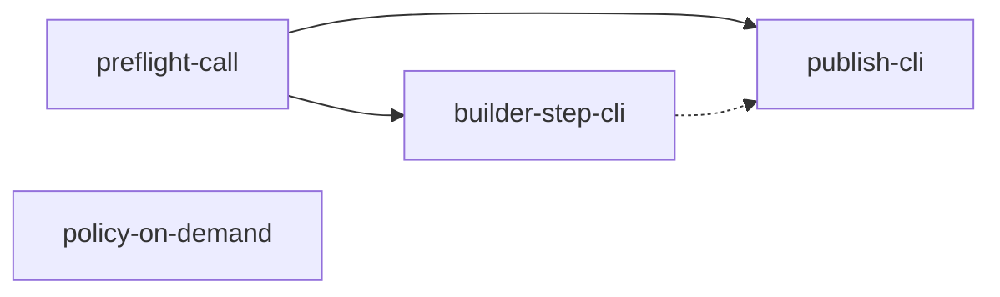

```yaml
initiative: spend-reduction
created: 2026-10-11
last-updated: 2026-10-11
```

# Spend reduction: on-demand policy, one preflight call, CLI-driven step commits and publishing

## Goal

Every Agento turn costs fewer tokens, and every delivery command takes fewer tool
round-trips. After this initiative:

- The always-on instruction payload in any workspace with the plugin is a small core
  instead of the full delivery policy. The full policy is loaded only by the agents
  and commands that cite it.
- Each `/agento …` command opens with one `agento.mjs preflight` call instead of
  `session` + `doctor --for` + `resolve` + `rev-parse`.
- A Builder step is one `agento.mjs step-commit` call instead of a hand-run
  fetch/merge/commit/commit/push/push/check sequence, and the Builder resume
  integration is one `agento.mjs sync` call.
- Planner publish, Reviewer publish, and the five PR → wait → merge flows are one
  CLI call each, resuming from git and GitHub state like `ship` does.

No delivery rule changes: git rules, guard verdicts, verification targets, pause
kinds, receipts, and window boundaries stay as specified. The work moves rules out
of the always-on payload and moves choreography into code.

## Decisions

The levers and delivery shape were chosen by the user in the planning chat on
2026-10-11:

- **Q: Which spend levers should the plan cover?** A: Shrink always-on
  instructions, CLI-ify multi-step git choreography, one preflight call per command
  (the three recommended options). Trimming prompt/agent prose and cheaper model
  pins were offered and not selected.
- **Q: How should this be delivered?** A: One initiative, one feature per lever
  (recommended).

The Architect's clarifying questions were then asked with the ask-questions tool.
The user was unavailable and asked for autonomous decisions, so each answer is the
option marked recommended:

- **Q: Delivery order for the four members?** A: Two waves (recommended):
  wave 1 `policy-on-demand` + `preflight-call` in parallel; wave 2
  `builder-step-cli` + `publish-cli`, both requiring `preflight-call`.
- **Q: How should spend reduction be measured?** A: Per-member measurement
  (recommended): each member's plan records before/after numbers for the
  always-on bytes and the tool-call count of a reference run.
- **Q: Size budget for the always-on policy core?** A: ≤ 40 lines always-on
  (recommended): work boundary, git musts, secrets, and a receipt one-liner;
  everything else on demand.
- **Q: Confirm what stays out of the initiative?** A: Confirm exclusions
  (recommended): prompt/agent prose trimming, model re-pinning, a Reviewer probe
  subagent, and extension changes beyond `npm run copy-cli`.

## Research

Skills consulted: agent-customization (built-in) — instruction files are applied
either through an `applyTo` glob or on demand through their `description`, and
"`applyTo: \"**\"` burns context … loads the instruction into the context window on
every interaction, even when irrelevant." The repository has no `.agents/skills/`
and no skills table in AGENTS.md.

### Always-on payload (measured 2026-10-11 on `main` `54ffd54`)

| File | `applyTo` | Lines | Bytes |
| --- | --- | --- | --- |
| `.github/instructions/delivery-policy.instructions.md` | `**` | 439 | 29 183 |
| `.github/instructions/command-invocation.instructions.md` | `**` | 60 | 1 919 |
| `.github/instructions/ai-skills.instructions.md` | `**` | 18 | 961 |

- About 32 KB (≈ 8K tokens) is attached to every request in every workspace that
  loads the plugin, including chats that never run an Agento command. In an agent
  loop it is re-sent with every tool-call turn.
- The policy has 12 sections (§1 L15 … §12 L394). §9 (receipts and the idempotency
  table, ~80 lines), §10 (capability preflight, ~70 lines), and §11 (window check,
  ~40 lines) matter only while an `/agento` command runs.
- Agents and prompts cite the policy by section 271 times (`grep -c '§'` over
  `.github/agents` and `.github/prompts`). They also link the file by name, so the
  citations survive a move only if the `§N` anchors stay resolvable.
- `tests/customizations.test.mjs` asserts that delivery-policy is the only file
  that spells out the shared rules (a canary list). It also checks the `Needs:` /
  `Fallback:` declarations and the `doctor --for` usage.
- In this session the SessionStart context block appeared twice. The likely cause
  is both wirings firing in one multi-root window: the workspace-mode
  `.github/hooks/session-start.json` of the Agento clone, and the plugin-mode
  `hooks/hooks.json` loaded for another workspace folder. To be confirmed by
  `policy-on-demand`.

### Preflight round-trips

- 18 prompts run `agento.mjs doctor --for <name>`, and 13 prompts and agents call
  `agento.mjs session`. Slug commands additionally call `resolve` or `find`, and
  every receipt needs `git rev-parse --short HEAD` for the operation ID.
- That is 3–4 tool round-trips before any work, and each one re-sends the full
  context.
- The roles table already lives in the CLI (`deriveAllowed` in
  `scripts/session-state.mjs`), so the CLI can also return the window-check
  verdict.

### Hand-run git choreography

- **Builder (every roadmap step).** Resume step 1 runs `git fetch` and merges
  `origin/<branch>` and `origin/<default>` in both halves. Work loop step 4 runs:
  1. commit the code;
  2. commit the roadmap tick and evidence in the companion (`git -C`);
  3. `git fetch`;
  4. check `merge-base --is-ancestor` for both defaults and merge when behind;
  5. push product, then push companion;
  6. confirm `companion.dirty: false` and `ahead: 0` via `agento.mjs session`.

  That is about 8–12 tool calls per step (`.github/agents/delivery-builder.agent.md`
  "Resume protocol" and "Work loop").
- **Planner step 8.** Four ordered sub-steps: companion commit and push, empty
  product commit and draft code PR, companion draft PR, an idempotent REST PATCH
  cross-link, and the `artifact-pr:` header commit
  (`.github/agents/delivery-planner.agent.md`).
- **Reviewer step 8.** Companion commit, merge of the companion default, push, a
  session check, and `gh pr comment` / `--edit-last`
  (`.github/agents/delivery-reviewer.agent.md`).
- **PR → wait → merge → sync, written out in prose five times:**
  `commit-current-changes` (steps 8–10), `finish-freehand` (7–9), `quick-fix`
  (7–9), the Architect's step 8 (`new-initiative`), and `triage-followups` step 5.
  Each one has its own companion-mode variant.
- **The pattern is proven.** `start-session`, `close-session`, and `ship` are
  already thin formatters over one resumable CLI call. Customizations tests assert
  "one `agento.mjs` call, no hand-run fallback" for each of them. The `ship` and
  `close-session` CLIs enforce the guard-equivalent rules in process, because the
  guard only sees `node agento.mjs …`.

## Features

### policy-on-demand

- Summary: Reduce the always-on instruction payload to a ≤ 40-line policy core and load the full delivery policy only where agents and commands cite it.
- Brief: "Keep a ≤40-line always-on core (work boundary, git musts, secrets, receipt one-liner); move §2–§12 into referenced, non-auto-applied file(s) keeping `§N` anchors; trim command-invocation to the redirect rule; dedupe SessionStart. Update the canary and cite tests in customizations.test.mjs. Risk: confirm VS Code loads instruction files linked from agent/prompt bodies."
- Requires: none
- Recommended after: none
- Wave: 1
- Size: M
- Independence: It changes only instruction files, their tests, and the SessionStart wiring. Every rule keeps its wording and its `§N` anchor, so agents, prompts, and the CLI behave the same whether or not the other members have shipped.

### preflight-call

- Summary: `agento.mjs preflight <command> [<type> <slug>]` returns the session record, the window-check verdict, the command's doctor checks, the roadmap resolution, the config, and the operation ID in one call, and every prompt and agent uses it.
- Brief: "`agento.mjs preflight <command> [<type> <slug>]` returning session, window-check verdict (with allowed/elsewhere), doctor for that command, resolve, config, and the op-id; every prompt/agent switches to it; update the `doctor --for` test, the needs-table test, and §9–§11 wording."
- Requires: none
- Recommended after: none
- Wave: 1
- Size: M
- Independence: It is an additive subcommand that composes existing in-process functions (`session`, `doctor`, `resolve`, `config`). The existing subcommands keep their output for the extension and other consumers, so switching the prompts is the only behavioural change.

### builder-step-cli

- Summary: `agento.mjs sync <type> <slug>` performs the Builder's integration of both halves, and `agento.mjs step-commit <type> <slug> --step N.M --message-file <f>` performs the two-commit, integrate, and push sequence of a roadmap step in one call.
- Brief: "`agento.mjs sync <type> <slug>` (fetch + merge-integrate both halves, never rebase, conflict → abort with files) and `agento.mjs step-commit <type> <slug> --step N.M --message-file <f>` (two-commit rule, integrate, push product then companion, draft PRs if missing, clean/ahead-0). Security: the guard can't see in-process git, so the CLI enforces the same rules (no default-branch commit, roadmap in the commit). Largest payoff — runs every step."
- Requires: preflight-call
- Recommended after: none
- Wave: 2
- Size: L
- Independence: The Builder's procedure keeps its order and rules; only the mechanics move into code. The subcommands embed the preflight checks that `preflight-call` defines, so they land after it. Neither one merges or marks PRs ready, so `ship` is unaffected.

### publish-cli

- Summary: `agento.mjs plan-publish`, `agento.mjs review-publish`, and one shared `agento.mjs publish-pr` replace the Planner and Reviewer publish steps and the five hand-run PR → wait → merge → sync flows.
- Brief: "`plan-publish`, `review-publish` (`--edit-last` comment), and one shared `publish-pr` (PR, bounded wait with exit 2 pending, `--merge`, sync, delete branch) used by commit-current-changes, finish-freehand, quick-fix, new-initiative, triage-followups."
- Requires: preflight-call
- Recommended after: builder-step-cli
- Wave: 2
- Size: L
- Independence: Each subcommand replaces one prose block, and the commands' authorizations stay unchanged. `publish-pr` merges only on the commands that already merge today (never delivery PRs, which stay `ship`'s), and a customizations test enforces that boundary. Landing after `builder-step-cli` lets it reuse that member's in-process commit, integrate, and push helpers, but that ordering is a recommendation, not a requirement.

## Recommended order

- **Wave 1 — policy-on-demand, preflight-call.**
  - They are independent of each other: one touches instruction files, the other
    adds a CLI subcommand and rewires prompt openings.
  - They can run in two concurrent sessions.
  - `policy-on-demand` is listed first and is the CLI's `next`, because it removes
    the fixed per-turn cost from every chat immediately.
- **Wave 2 — builder-step-cli, publish-cli.**
  - Both embed the preflight contract, so both require `preflight-call`.
  - `builder-step-cli` comes first because it runs on every roadmap step.
  - `publish-cli` follows it to share its commit, integrate, and push helpers.



## Risks

- **Linked instruction files may not load from agent and prompt bodies.** If
  VS Code does not pull a linked `.instructions.md` into context, rules cited as
  `§N` would silently disappear. *Mitigations:*
  - `policy-on-demand` verifies the loading behaviour first, in a real chat on the
    current VS Code;
  - if linked files do not load, it falls back to a narrow `applyTo` plus a
    `description` (on-demand discovery), or keeps the sections agents need inline
    in the agent files;
  - the canary test keeps each rule spelled out exactly once.
- **CLI-side commits and pushes bypass the delivery guard.** *Mitigations:*
  `builder-step-cli` and `publish-cli` enforce the guard's rules in process, as
  `ship` and `close-session` do today:
  - never commit or push the default branch;
  - never force or rebase;
  - the roadmap goes in the step commit;
  - normal merges only.

  New CLI tests mirror the matching guard fixtures, and a customizations test
  restricts which prompts may call the merging subcommands.
- **`publish-pr` could become a back door to merging delivery PRs.**
  *Mitigation:* it refuses `feature/`, `issue/`, and `post-ship/` branches. Only
  `/agento ship` merges those, and the existing "only ship references
  `agento.mjs ship`" test gets a sibling for `publish-pr`.
- **Fewer, larger tool calls hide intermediate failures from the model.**
  *Mitigation:* every new subcommand returns the `ship`-style JSON contract:
  - `status` with `phase`, `actions[]`, and `message`;
  - exit 2 for pending and exit 3 for rejected or failed;
  - a `reauth` hint on auth failures.

  Re-sending resumes from git and GitHub state, never from a journal.
- **Concurrent wave-1 and wave-2 sessions edit shared files.** Members touch the
  same prompts, `docs/commands.md`, `CHANGELOG.md`, and the generated
  `extension/cli/` copy. *Mitigations:* integrate `origin/main` by merge before
  every push, and regenerate `extension/cli/` with `npm run copy-cli`.
- **The token saving is not observable without a baseline.** *Mitigation:* each
  member records before/after numbers in its plan: the always-on bytes and the
  tool-call count of a reference `/agento ap` run taken from the chat debug log.

## Out of scope

- Trimming prompt and agent prose beyond what the moved rules require.
- Changing model pins (the Autopilot and `ship` stay on their current models).
- A Reviewer test-writing subagent on a cheaper model, evaluated and rejected in
  the planning chat.
- Extension changes beyond regenerating `extension/cli/` with `npm run copy-cli`.
- New lifecycle states, new slash commands, or changes to the §8 window boundaries
  and §9 receipt spellings.

## Definition of done

- The always-applied instruction payload in this repository is at most the
  ≤ 40-line policy core plus `ai-skills`, and its byte count is recorded against
  the 2026-10-11 baseline above (32 063 bytes).
- Every `/agento …` prompt and agent opens with one `agento.mjs preflight` call.
  No prompt calls `session`, `doctor --for`, and `resolve` separately for its own
  window check.
- A Builder roadmap step commits, integrates, and pushes through one `agento.mjs
  step-commit` call. Planner publish, Reviewer publish, and the five PR → wait →
  merge flows are one CLI call each, with "one call, no hand-run fallback"
  customizations tests.
- A reference `/agento ap` run takes measurably fewer tool calls than the baseline
  recorded by `builder-step-cli`.
- Every member's full gate is green: node tests, both replay-guard runs,
  shellcheck, and the extension unit tests after `npm run copy-cli`.
