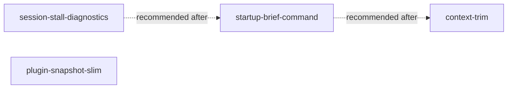

```yaml
initiative: agento-speed
created: 2026-11-03
last-updated: 2026-11-03
```

# Agento speed: remove the stalls, shrink the startup ritual, trim the context

## Goal

Delivery sessions stop losing wall-clock time to things that are not the model or the
work: the 60 s per-turn stalls and 400–575 s subagent start-ups caused by a broken MCP
server become visible in `doctor` and the dashboards instead of silently eating hours;
the "128 tools" warning disappears; a Builder or Autopilot gets everything it needs to
start in one CLI call instead of ~25 reads (several of which block unattended runs on a
permission prompt); every file an agent reads fits under the 20 KB `view` truncation; the
per-call context and the plugin snapshot both shrink. Net effect: an unattended
overnight build spends its time building.

## Decisions

Scope form (plan mode):

- "Which workstreams should become Agento deliveries?" → `stall, tools, brief, context,
  plugin, substart` (all six; recommended default was `stall, tools, brief`).
- "Run the hidden-window stall experiment now (before planning the fix)?" → `true`
  (recommended). Outcome: hidden-window throttling ruled out; root cause found in the CLI
  process log (Railway MCP `tools/list` timeouts).
- "Railway MCP (72 tools, global)" → `remove` — "I'll remove it from
  ~/.copilot/mcp-config.json myself" (recommended).
- "How to package the Agento work" → `initiative` — "One initiative
  (/agento new-initiative) decomposed into features" (recommended).

Decomposition form (Architect step 3):

- "Which feature should ship first?" → `diagnostics` — "Diagnostics first: doctor MCP
  check + stall metrics + Autopilot browser drop" (recommended).
- "Shape of the one-call startup bundle" → `new-subcommand` — "New `agento.mjs brief
  <command> <slug>` subcommand; commands/agents call it in place of policy+reads"
  (recommended).
- "Target size of a member feature (S ≈ one Builder session, M ≈ a day, L ≈ multi-day)"
  → "Seems reasonable" (recommended default `M` accepted).

Dropped from the brief's original todo list after the experiment: `stall-flags`
(Chromium no-throttle launch flags — not the cause) and `subagent-start-investigate`
(explained by the same MCP timeouts; re-checked by the verification step of
`session-stall-diagnostics`).

## Research

Skills consulted: none — no matching domain (this repository's AGENTS.md has no
`## Agento` skills table; the VS Code `troubleshoot` plugin skill was used for the log
analysis that produced the brief).

Evidence (outside the repository, captured in the brief):

- `~/.copilot/session-state/<id>/events.jsonl` for sessions `10097e97…`, `532d960c…`,
  `6e6fbbb2…`, `a967ed16…`: `tool.execution_complete → assistant.turn_end` gaps of
  60.04 ± 0.05 s (349×) plus a 40–54 s hump (TCP backoff), 458 stalls ≈ 7.4 h in one
  35 h session; `subagent.started → subagent.configured` gaps of 402–575 s.
- `~/.copilot/logs/process-1793628432642-1249106.log`: `rmcp::service cancelled …
  "request timeout"` 590× and `tool_catalog] Failed to list MCP tools … {"server":
  "railway","error":"MCP request timed out after 59999 ms"}`; `Railway MCP proxy error:
  error reading SSE stream from remote MCP server` 934×.
- `~/.copilot/mcp-config.json`: `railway` with `"tools": ["*"]` → 72 tools (probed via
  `tools/list`), on top of ≈ 77 built-ins → > 128.
- Hooks (`delivery-guard` pre/post) total 8 s per hour; model inference ≈ 20 % of wall
  clock. Neither is a target.

Codebase (Explore subagent):

- Doctor checks: `scripts/lib/doctor.mjs` — `DOCTOR_CHECKS` functions return
  `{ status: ok|warn|fail, detail, fallback }`; `runDoctor()` aggregates with
  `STATUS_RANK`; `COMMAND_NEEDS` / `CAPABILITY_CHECKS` / `checksFor()` select checks for
  `doctor --for <command>`; the `gh()` check is the template. Rendering in
  `scripts/commands/doctor.mjs` (`emit`); tests in `scripts/commands/doctor.test.mjs`.
- Metrics: `scripts/delivery-metrics.mjs` is pure over `git log -p` text (no filesystem,
  no session state) — `parseArtifactLog`, `parseMergeLog`, `deriveMetrics`,
  `aggregateMetrics`; consumed by `metricsDocument()` / `dashboardDocument()` in
  `scripts/lib/documents.mjs` via `scripts/commands/status.mjs`; displayed by
  `extension/src/deliveryTimeline.ts`, `extension/src/extension.ts`, and
  `canvas/agento-mission-control/snapshot.mjs` (`buildTimeline`). A session-events reader
  is new surface; keep the pure parser/derivation split.
- Session & Doctor view: `extension/src/sessionDoctorModel.ts` (`DoctorCheck`,
  `parseChecks`, `createSessionDoctorModel`) and `extension/src/sessionDoctorProvider.ts`
  (`getChildren`, `worstCheckStatus`). Canvas feed: `canvas/agento-mission-control/public/panels/feed.js`.
- Policy and preflight: `policySections(root)` in `scripts/commands/doctor.mjs` slices
  `.github/instructions/delivery-policy.instructions.md` on `^## N. ` headings and returns
  `{ n, title, bytes, raw }`; `preflightDocument()` returns `status, command, opId,
  subject, receipt, preflightLines, window, session, doctor, resolve?`. New subcommands
  register in `COMMAND_MODULES` (`scripts/agento.mjs:48–80`) and export
  `commands[name]`; fixtures in `scripts/test-helpers/agento-fixtures.mjs`.
- Roadmap steps: `scripts/delivery-roadmap-resolver.mjs:67–83` parses numbered checklist
  steps with `done` and `verify:` text; `scripts/lib/records.mjs:39–57` counts ticks. No
  exported "current unticked step" helper yet — the resolver's step parser is the base.
- Frontmatter tests: `tests/customizations.test.mjs` requires nonempty, recognised
  `tools`, `Needs:`/`Fallback:` as the first two body lines, `Needs:` tokens in policy §10
  and matching the CLI capability table. Dropping `browser` from the Autopilot agent
  passes as long as its `Needs:` line and `COMMAND_NEEDS` stay consistent.
- Plugin copy: no export step produces `/home/david/DP/agento-plugin`; nothing excludes
  `extension/node_modules` (162 MB) or `.git` from the snapshot VS Code takes.
- Autopilot model: profiles in `scripts/model-profiles.mjs` (`~/.config/agento/model-profiles.json`,
  `AGENT_ALIASES`), `scripts/commands/models.mjs` (`use`, `apply`, `adopt`),
  `scripts/lib/models.mjs` applies pins to agent frontmatter.
- Sizes: `delivery-policy.instructions.md` 20,109 B and `agento-init.prompt.md` 20,296 B
  (both just over the 20 KB `view` limit); Builder `Policy:` line lists 11 of 12 sections.

## Features

### session-stall-diagnostics

- Summary: Make MCP-induced turn stalls and tool-budget overflow visible in `doctor`,
  `delivery-status`, Mission Control and the Session & Doctor view, and drop `browser`
  from the Autopilot agent.
- Brief: "Remove Railway MCP (user, 1 min) and make this class of failure visible
  (Agento)" — the `doctor` MCP check (wildcard / remote-proxy servers in
  `~/.copilot/mcp-config.json` and the workspace `.vscode/mcp.json`; `MCP request timed
  out` counts per server from the newest `~/.copilot/logs/process-*.log`), the
  `delivery-metrics` stall detector (tool→next-turn gaps ≥ 40 s and
  `subagent.started → configured` gaps per session from `events.jsonl`), the dashboard
  surface ("N stalled turns (~M min) — check `doctor`"), the `docs/copilot-harness.md`
  "Known stall sources" section, the Autopilot `browser` drop, and the
  `railway-remove-verify` step (fresh session shows no timeouts, no tool warning, no 60 s
  gaps).
- Requires: none
- Recommended after: none
- Wave: 1
- Size: M
- Independence: Pure additions to doctor, metrics, and the two dashboards plus one
  frontmatter edit; no command text or router changes, so it ships and proves the fix
  before anything else moves.

### startup-brief-command

- Summary: Add `agento.mjs brief <command> <slug>` that prints everything an agent needs
  to start in one host-approved call, route the router/commands/agents through it, split
  the policy into per-section files under 20 KB, and add long-command `initial_wait`
  guidance.
- Brief: "One-call briefing instead of the ~25-call startup ritual" — `brief` printing
  receipt + preflight lines, the dispatched command body, the agent body when inline, the
  `Policy:` sections, the roadmap header + the *current* unticked step with its
  `verify:`, and companion paths; `skills/agento/SKILL.md`, command files and agents
  replaced to call it; the rule "never `view` files under `<agento-root>` — use CLI
  output"; `delivery-policy.instructions.md` split into per-section files read by
  `policy N`; `agento-init.prompt.md` under 20 KB; Builder guidance `initial_wait ≥ 120`
  for build/test/db commands.
- Requires: none
- Recommended after: session-stall-diagnostics
- Wave: 2
- Size: L
- Independence: The subcommand, its tests, and the text rewiring land together and
  replace an existing read sequence one-for-one; the mirrors
  (`skills/agento/commands/`, `extension/cli/`) are regenerated in the same delivery, so
  nothing else has to change for it to be useful.

### context-trim

- Summary: Cut the Builder's `Policy:` section list to what it acts on, move the
  Autopilot to a cheaper/faster default model profile, and document disabling the
  Python/Pylance synced customizations for non-Python workspaces.
- Brief: "Trim per-call context" — Builder `Policy:` lists 11 of 12 sections (the whole
  file); cut to the sections the Builder acts on, rest on demand; Autopilot on a
  cheaper/faster profile (≈ 8 short turns; Opus hit "Credit limit reached"); user note on
  disabling the 7 Python/Pylance skills that appear in every prompt.
- Requires: none
- Recommended after: startup-brief-command
- Wave: 2
- Size: S
- Independence: Frontmatter, `Policy:` lines, model-profile defaults, and docs only;
  valid against the current policy file and against the split one, so it does not need
  `startup-brief-command` to land first.

### plugin-snapshot-slim

- Summary: Produce the plugin copy without `extension/node_modules` and `.git`, and clean
  stale plugin entries, so each VS Code snapshot drops from ≈ 182 MB to a few MB.
- Brief: "Slim plugin snapshots" — publish `/home/david/DP/agento-plugin` without
  `extension/node_modules` and `.git` (archive-style export or loader ignore file if
  supported); drop the stale `/tmp/agento-scratch-plugin` entry.
- Requires: none
- Recommended after: none
- Wave: 2
- Size: S
- Independence: A new export script (plus doctor/docs mention) that touches no agent
  text or CLI behaviour; the plugin keeps working from either copy.

## Recommended order

- **Wave 1 — `session-stall-diagnostics`.** The user's Railway removal already fixes the
  stalls and the tool warning; this feature proves it (verification step) and makes the
  failure class visible so it cannot silently return. Smallest surface, no text churn.
- **Wave 2 — `startup-brief-command`, `context-trim`, `plugin-snapshot-slim`** in any
  order; all three are independent of wave 1 and of each other. `context-trim` is
  suggested after `startup-brief-command` only so the Builder's trimmed `Policy:` list is
  written against the split section files once, not twice.



## Risks

- The stall detector reads `~/.copilot/session-state/*/events.jsonl` and
  `~/.copilot/logs/process-*.log`, which are undocumented Copilot CLI internals and may
  change shape. Mitigation: keep the reader thin and tolerant (unknown event types
  ignored; missing files → `ok` with "no session data"), fixture the exact lines seen in
  the brief, and never `fail` on parse errors — `warn` at most.
- `brief` could grow into a second system prompt and re-create the context cost it
  removes. Mitigation: print only the current roadmap step (not the plan), the policy
  sections the command's `Policy:` line names, and cap output; a test asserts the bundle
  stays under a byte budget for the fixture repository.
- Rewiring every command/agent file risks drift between `.github/prompts/`,
  `skills/agento/commands/`, and `extension/cli/`. Mitigation: the existing mirror tests
  (`tests/customizations.test.mjs`, the copy-cli byte check) gate the PR.
- Changing the Autopilot model changes behaviour in unattended runs. Mitigation: a
  profile default, not a hard pin — `models use` restores the old one.
- The plugin snapshot filter depends on how VS Code copies plugins (no documented ignore
  file). Mitigation: export a clean tree (`git archive` plus the generated
  `extension/cli/`), not an in-place filter; verify the loaded snapshot size.

## Out of scope

- Fixing or replacing the Railway MCP server itself (environment; the user removes the
  entry).
- Hook latency (8 s per hour) and model inference speed.
- Chromium / VS Code window-throttling flags (ruled out by experiment).
- Prompt-caching behaviour of BYOK providers.
- Disabling Python/Pylance synced customizations (user environment; documented only).
- Any change to the ship, review, or planning flows beyond the startup bundle.

## Definition of done

- `agento doctor` warns on wildcard/remote MCP servers and recent MCP timeouts;
  `delivery-status`, Mission Control, and the Session & Doctor view show stalled-turn
  counts for the current session; a fresh session after the Railway removal shows zero
  stalls, no tool warning, and `docs/copilot-harness.md` documents the stall source.
- A Builder or Autopilot start is one `agento.mjs brief` call with no `view` of files under
  `<agento-root>` and no permission prompt; every agent-read file in the plugin is under
  20 KB; the three mirrors are byte-identical where required.
- The Builder's `Policy:` line names only the sections it acts on; the Autopilot's default
  profile is the cheaper model.
- The plugin snapshot under `~/.config/Code/agentPlugins/` is under 10 MB.
- All four member roadmaps report `status: complete` and `agento.mjs initiative agento-speed`
  reports the initiative complete.
